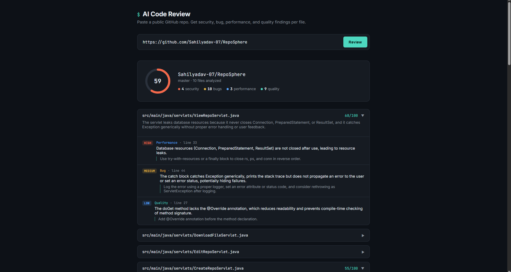
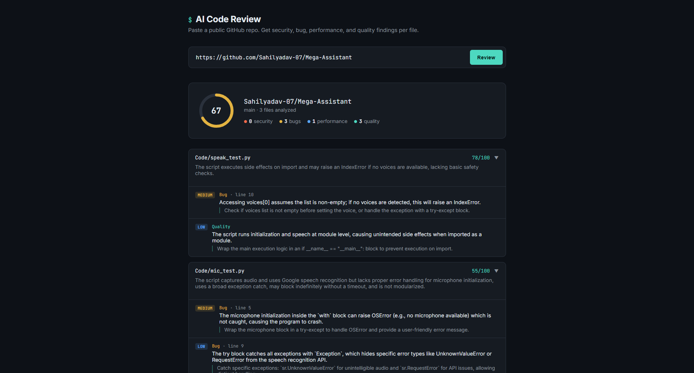
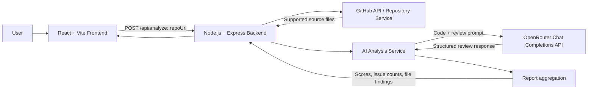

# AI Code Review

An AI-powered code review tool that analyzes source files from a **public GitHub repository** and reports potential security issues, bugs, performance concerns, and code-quality improvements.

## Screenshots

### Review a Java repository


### Review a Python repository


## Architecture



**Review flow:** Submit a public repository URL → fetch and filter source files → analyze files with an AI model → aggregate scores and findings → display a file-by-file report.

## Features

- Analyze supported source files from public GitHub repositories
- Detect potential security, bug, performance, and code-quality issues
- Show per-file summaries, quality scores, issue severity, and suggested fixes
- Aggregate findings into an overall score and category counts
- Run multiple file reviews concurrently

## Tech stack

- **Frontend:** React, Vite, JavaScript, CSS
- **Backend:** Node.js, Express.js, Axios
- **Integrations:** GitHub API, OpenRouter API
- **Output:** Structured JSON analysis reports

## Run locally

**Requirements:** Node.js and npm, an OpenRouter API key, and internet access.

1. Clone the repository and enter the project folder:

   ```bash
   git clone https://github.com/Sahilyadav-07/AI-Code-Review.git
   cd AI-Code-Review
   ```

2. Configure the backend environment. Create `backend/.env` (or copy `backend/.env.example`) and set:

   ```env
   OPENROUTER_API_KEY=your_openrouter_api_key
   OPENROUTER_MODEL=your_openrouter_model_id
   GITHUB_TOKEN=
   PORT=4000
   ```

   Keep your real API key private. Never commit `.env` or paste secrets into `README.md`.

3. Install dependencies and start the backend in one terminal:

   ```bash
   cd backend
   npm install
   npm run dev
   ```

4. In a second terminal, install dependencies and start the frontend:

   ```bash
   cd frontend
   npm install
   npm run dev
   ```

5. Open the local URL printed by Vite. The backend health endpoint is `http://localhost:4000/api/health`.

## Notes

- The tool is intended for public repositories and currently analyzes the source files supported by its repository-fetching logic.
- AI findings are suggestions, not a guarantee that every issue has been found. Review important findings manually.
- Analysis time and available usage depend on repository size, the selected OpenRouter model, and API rate limits.
- Do not submit private code or secrets to an external AI API unless you have permission to do so.

---

Built by [Sahil Yadav](https://github.com/Sahilyadav-07).
